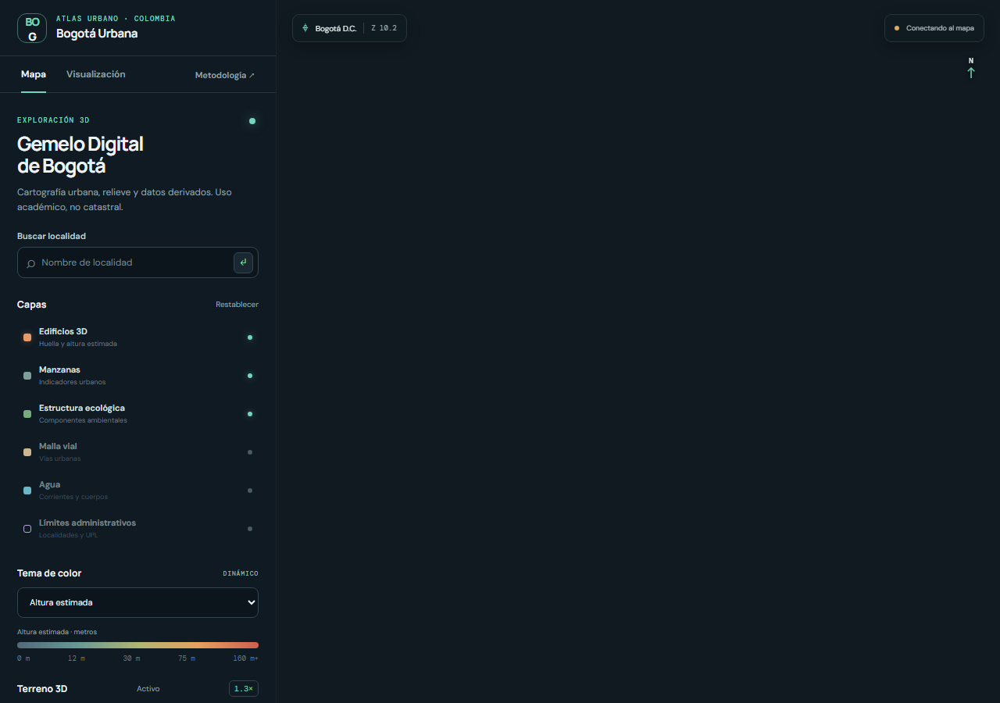

# Gemelo Digital Urbano de Bogotá

Visor web experimental para explorar el relieve, la forma urbana y datos espaciales abiertos de Bogotá D.C. El proyecto integra procesamiento geoespacial reproducible, visualización 3D y publicación estática.

<p align="center">
  
</p>

<p align="center">
  <a href="https://stiagogomezt.github.io/MAPABOGOTA/">Abrir visor</a> ·
  <a href="https://stiagogomezt.github.io/MAPABOGOTA/metodologia.html">Metodología y fuentes</a> ·
  <a href="docs/METADATOS.md">Inventario de datos</a>
</p>

## Acerca del proyecto

Este prototipo académico explora cómo combinar cartografía oficial, modelos de elevación y productos 3D ligeros en una experiencia web sin paso de compilación. La interfaz está construida con MapLibre GL JS y PMTiles, con una página de metodología y espacios para un sobrevuelo renderizado en Blender y un modelo GLB.

El procesamiento geoespacial se realiza en MAGNA-SIRGAS / Origen-Nacional (EPSG:9377). Los GeoJSON y PMTiles de publicación usan WGS 84 (EPSG:4326), y MapLibre proyecta la vista en Web Mercator (EPSG:3857). Los detalles de procedencia, licencias, CRS, linaje y limitaciones están en [`web/metodologia.html`](web/metodologia.html) y [`docs/METADATOS.md`](docs/METADATOS.md).

> El visor es un estudio académico, no un producto catastral oficial. Las alturas e indicadores derivados son aproximados y no deben usarse para decisiones prediales. No se publican propietarios ni otros datos personales.

## Estado del visor

El sitio estático y sus controles están implementados. Los datos cartográficos y medios solo se muestran cuando las fases de procesamiento los generan y registran en `web/manifest.json`. Si el manifiesto está vacío, el mapa base y la interfaz siguen funcionando, pero las capas locales, el video y el GLB no están disponibles todavía.

## Funcionalidades

- Mapa MapLibre con relieve 3D y exageración vertical ajustable.
- Panel de capas, temas de color, leyenda, escala, orientación y coordenadas.
- Búsqueda de localidades y sobrevuelo pausables por 20 localidades.
- Popups cartográficos con atributos seleccionados, sin campos personales.
- Panel de medios para video MP4 y modelo GLB con controles de órbita.
- Página de metodología con fuentes, CRS, procesamiento, privacidad y autoría.
- Diseño adaptable a escritorio y celular. Recursos externos del visor usan versiones CDN fijas.

## Empezar en local

Sirve la carpeta `web/` con un servidor HTTP estático:

```powershell
python -m http.server 8000 --directory web
```

Abre `http://localhost:8000`. No se necesita Node.js ni un proceso de build para el visor. MapLibre GL JS 5.6.1, PMTiles 4.3.0 y three.js 0.180.0 se cargan desde CDN.

## Procesamiento reproducible

El entorno Python se gestiona con `uv`. La cadena completa requiere QGIS con GDAL y soporte PMTiles, además de Blender para las salidas 3D.

```powershell
uv sync
uv run python scripts/run_all.py --validate-only
uv run python scripts/acquire_sources.py
cmd /c scripts/run_phase2.bat
cmd /c scripts/run_phase3.bat
```

Para continuar una Fase 2 interrumpida y reutilizar capas ya validadas:

```powershell
cmd /c scripts/run_phase2.bat --resume
```

Si las capas de Fase 2 terminaron pero hay que reconstruir la publicación web, sin rehacer indicadores ni recortes:

```powershell
cmd /c scripts/run_phase2.bat --export-only
```

## Auditoría y control de calidad

Después de terminar Fase 2, valida los GeoPackages y el visor. La evaluación parcial y sus limitaciones están en [`docs/AUDITORIA_FASE6.md`](docs/AUDITORIA_FASE6.md):

```powershell
cmd /c scripts/run_audit_phase6.bat --base-url http://localhost:8000
uv run python -m unittest discover -s tests -v
```

La auditoría registra CRS, envolventes transformadas, campos clave, valores nulos, nombres de campos sensibles, tamaños y artefactos temporales. El control de coordenadas de ida y vuelta comprueba consistencia numérica, no exactitud posicional. Para evaluar exactitud se necesitan puntos de control independientes y tolerancias definidas. La medición HTTP local tampoco reemplaza una prueba de primera pintura en una red/dispositivo móvil real.

Las fuentes originales y productos intermedios se conservan localmente en `data/raw/` y `data/processed/`, ignorados por Git. Consulta [`docs/DESCARGAS_MANUALES.md`](docs/DESCARGAS_MANUALES.md), [`docs/BITACORA.md`](docs/BITACORA.md) y [`docs/METADATOS.md`](docs/METADATOS.md) para los procedimientos y registros.

## Publicación

GitHub Actions publica únicamente `web/` en GitHub Pages mediante `actions/deploy-pages`. El workflow comprueba que las rutas declaradas en el manifiesto existan y aplica límites de tamaño antes de desplegar. El despliegue se ejecuta al actualizar `main` o manualmente desde Actions.

Los archivos generados de datos y multimedia están ignorados por Git por defecto. Antes de agregarlos explícitamente al sitio, confirma licencia de redistribución, ausencia de atributos personales, integridad del archivo y límites de tamaño, y actualiza `web/manifest.json`.

## Estructura

| Ruta | Propósito |
| --- | --- |
| `web/` | Sitio estático publicado en GitHub Pages |
| `scripts/` | Adquisición y procesamiento con PyQGIS/GDAL |
| `blender/` | Construcción de escena y exportación 3D |
| `data/raw/` | Fuentes locales originales, ignoradas por Git |
| `data/processed/` | Capas intermedias y proyectos GIS locales |
| `docs/` | Bitácora, metadatos, reportes y capturas |
| `tests/` | Pruebas automatizadas disponibles |

## Autor

Santiago Gómez · estudiante de Ingeniería Catastral y Geodesia en Bogotá, Colombia.

Proyecto académico independiente. Las fuentes y servicios pertenecen a sus respectivas entidades y conservan sus propias licencias y condiciones de uso.
