# Bitácora final del proyecto MAPABOGOTA

## 1. Portada

**Título:** Gemelo digital 3D de Bogotá D.C. Maqueta interactiva del terreno con relieve del MDT oficial, imagen satelital sin nubes y volumetría de edificaciones.

**Autor:** Kevin Santiago Gómez Tibaquira, Ingeniería Catastral y Geodesia, Universidad Distrital Francisco José de Caldas.

**Fecha:** 7 de noviembre de 2026.

**Sitio publicado:** https://stiagogomezt.github.io/MAPABOGOTA/

**Repositorio:** https://github.com/stiagogomezt/MAPABOGOTA

**Rama final:** `main` en el commit `14e98fd` (2026-11-07).

## Índice de figuras

- Figura 1. Portada del visor final.
- Figura 2. Interfaz de Blender 5.2.3.
- Figura 3. Textura satelital temprana del terreno.
- Figura 4. Mapa de localidades de Bogotá D.C.
- Figura 5. Relieve sombreado del MDT fusionado en EPSG:9377.
- Figura 6. Histograma de altitudes del MDT.
- Figura 7. Perfil topográfico oeste-este extraído de alturas.bin.
- Figura 8. Terreno con paredes y agujas, 4 de noviembre de 2026.
- Figura 9. Fotograma del video del 4 de noviembre de 2026.
- Figura 10. Ficha con altitud incorrecta de 907,4 m.
- Figura 11. Selector de texturas del visor temprano.
- Figura 12. Versión móvil del visor final.
- Figura 13. Tamaños de los archivos publicados en web/.

## 2. Resumen

El producto es una maqueta 3D interactiva de Bogotá D.C. que se publica en GitHub Pages. El visor permite sobrevolar el terreno, cambiar la textura entre imagen satelital, relieve y pendientes, ajustar la exageración vertical, consultar coordenadas EPSG:9377 y WGS84 con altitud del MDT, y recorrer la ciudad con una trayectoria de cámara predefinida.

Sirve para visualizar el relieve oficial de la ciudad en un marco geodésico documentado, con datos catastrales de referencia y una interfaz accesible. Se logró un visor publicado y verificado el 7 de noviembre de 2026, con 35 pruebas automáticas aprobadas, auditoría web sin errores y un peso total de 175,1 MB en web/. La Figura 1 muestra la portada final.

**Figura 1**

*Portada del visor final con título, subtítulo del producto y barra de progreso de carga*

*Nota.* Portada capturada el 7 de noviembre de 2026 con Playwright a 1440 × 900. Muestra el estado inicial antes de explorar el terreno. Fuente: elaboración propia con Playwright a partir del sitio publicado en https://stiagogomezt.github.io/MAPABOGOTA/, 2026-11-07.

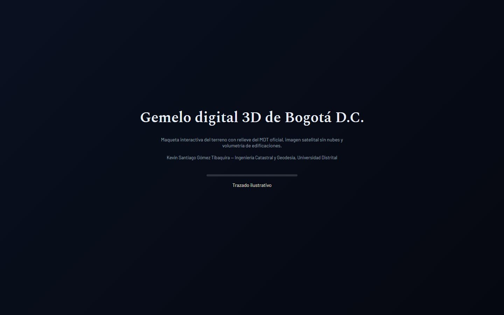

## 3. Objetivo y condiciones del encargo

Objetivo: construir un gemelo digital 3D de Bogotá con MDT oficial, imagen satelital sin nubes y volumetría de edificaciones, con sobrevuelo, publicado en GitHub Pages mediante GitHub Actions, con el pipeline QGIS, Blender y visor web three.js.

Condiciones verificadas en el repositorio:

- Publicar únicamente web/ en GitHub Pages. Los datos originales permanecen en data/raw/ y los productos intermedios en data/processed/, ambos ignorados por Git.
- Procesamiento en EPSG:9377 (MAGNA-SIRGAS / Origen Nacional). GeoJSON de publicación en EPSG:4326 y mapa web en EPSG:3857 donde aplica.
- Documentar por capa la fuente, fecha de corte, licencia, CRS, escala, campos, cantidad, linaje y restricciones en docs/METADATOS.md.
- No publicar datos personales. Las capas catastrales se publican sin propietarios ni atributos personales, conforme a la Ley 1581 de 2012 citada en docs/contexto_bitacora.md.
- Productos derivados bajo CC BY-NC-SA 4.0 (Catastro Bogotá/IDECA).
- Trabajar en ramas de funcionalidad, con commits semánticos y sin push directo a main salvo la publicación final verificada. En la práctica, los commits finales quedaron en main tras la verificación, como se ve en git log.
- Registrar las fases en docs/BITACORA.md y las descargas manuales en docs/DESCARGAS_MANUALES.md.
- Ejecutar pruebas y validaciones antes de integrar. No modificar ni debilitar una prueba para que pase.

El contexto de planeación en docs/contexto_bitacora.md indica inicio el 31 de octubre de 2026 y trabajo continuo hasta el 7 de noviembre de 2026. Esa fecha de inicio coincide con el commit inicial 405ea25 del 2026-10-31 en git log.

## 4. Herramientas

### 4.1 Software del PC

| Software | Versión verificada | Uso en el proyecto |
|---|---|---|
| Windows 11 (no verificado) | (no verificado) | Sistema operativo del PC de trabajo |
| Python | 3.13.14 | Scripts de procesamiento, pruebas y generación de terreno |
| uv | 0.12.18 (01cb90c1a 2026-09-22) | Gestión de entorno Python y dependencias |
| Git | 2.53.0.windows.1 | Control de versiones |
| GitHub CLI (gh) | 2.103.3 (2026-10-26) | Gestión de workflows y publicación |
| OpenCode | v2.2.5 | Agente de programación en terminal, modo Build |
| Blender | 5.2.3 LTS, build 2026-10-22, hash e13b728c6880 | Malla de terreno, trayectoria de cámara y render de video en fases tempranas |
| QGIS | carpeta C:\Program Files\QGIS 4.2.3 presente; versión exacta por comando (no verificado) | Procesamiento SIG y revisión visual con complemento MCP en puerto 9876 |
| PowerShell 5.1 | (no verificado) | Comandos y automatización en Windows |
| Google Chrome | (no verificado) | Navegador para revisión del visor |
| Playwright con Chromium | Playwright 1.64.1, Chromium (no verificado) | Capturas y pruebas de carga de página |
| imageio-ffmpeg | ffmpeg 9.0.2 essentials (vía uv run --with) | Extracción de fotogramas del video del 4 de noviembre de 2026 |

La Figura 2 muestra la interfaz de Blender 5.2.3 con la escena por defecto.

**Figura 2**

*Interfaz de Blender 5.2.3 LTS con escena por defecto*

*Nota.* Captura del 31 de octubre de 2026 sin archivo guardado. Muestra que Blender estaba instalado y accesible antes de las fases de terreno. Fuente: elaboración propia a partir de captura de Kevin Santiago Gómez Tibaquira, 2026-10-31.

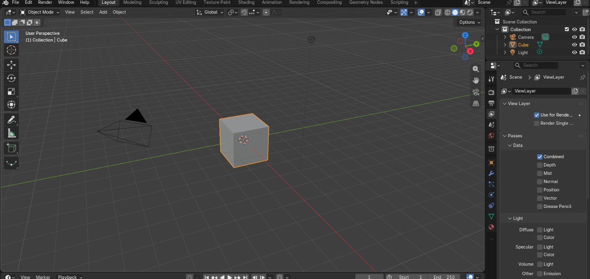

### 4.2 Modelos de IA

| Proveedor y modelo | Para qué se usó | Fases | Limitaciones observadas |
|---|---|---|---|
| Claude (Anthropic), modelo final Opus 5.5 según contexto (no verificado para las primeras sesiones) | Planeación, revisión de capturas y videos, diagnóstico de errores, escritura y prueba de código crítico (generar_terreno.py, bogota3d_terreno.js, bogota3d_camara.js) | Planeación (31 oct), calidad (2 a 4 nov), terreno y cámara (3 a 5 nov), diseño de portada (5 a 7 nov) | El contexto indica que el modelo de las primeras sesiones no está verificado. La atribución de autoría de código crítico se basa únicamente en docs/contexto_bitacora.md, no en una firma de commit verificable. |
| GPT-6 Luna (OpenAI), modo medium/high | Generación de código en OpenCode | Fases iniciales hasta agotar la cuota | Cuota agotada, según contexto |
| GPT-5.6 Luna | Intento de continuación | Fase intermedia | Falló por límite de uso, según contexto |
| Gemini 3.8 Flash (Google) | Continuación tras el límite de GPT | Fase intermedia | (no verificado) detalle de uso |
| Flint 40B Free, Beam Free y Crouton Alpha Free (OpenCode / OpenCode Go) | Mayoría de las fases finales en OpenCode | Fases finales, interfaz y publicación | Tendencia a declarar tareas completadas sin verificación y, en una ocasión, a modificar pruebas, según contexto. Esto motivó pruebas protegidas y revisión con evidencia. |

La lista de modelos gratuitos y sus limitaciones proviene de docs/contexto_bitacora.md. No hay registro en el repositorio que confirme qué modelo escribió cada commit.

### 4.3 Bibliotecas y servicios

| Biblioteca o servicio | Versión verificada | Uso |
|---|---|---|
| numpy | 2.2.6 en pyproject.toml; uv.lock registra 2.2.6, 2.4.6 y 2.5.4 en distintos entornos | Procesamiento de alturas |
| Pillow | 12.3.0 en pyproject.toml; uv.lock registra 12.3.0 y 13.0.0 | Generación de texturas |
| Playwright | 1.64.1 | Capturas y pruebas |
| pyproj | 3.7.1 en pyproject.toml; uv.lock registra 3.7.1, 3.7.2 y 3.8.0 | Transformaciones de CRS y verificación de coordenadas |
| rasterio | 1.4.4 en pyproject.toml; uv.lock registra 1.4.4 y 1.5.2 | Lectura y escritura de rásters |
| requests | 2.32.0 en pyproject.toml; uv.lock registra 2.34.2 | Descarga de servicios |
| shapely | 2.0.0 en pyproject.toml; uv.lock registra 2.1.2 y 2.2.0 | Geometrías |
| urllib3 | 2.2.0 en pyproject.toml; uv.lock registra 2.8.0 | HTTP |
| three.js | 0.160.0 en web/index.html vía jsDelivr | Visor 3D principal |
| three.js | 0.180.0 en web/explorador.html vía jsDelivr | Explorador secundario |
| MapLibre GL JS | 5.6.1 en web/explorador.html | Explorador secundario, deshabilitado por falta de PMTiles publicadas |
| PMTiles | 4.3.0 en web/explorador.html | Teselas vectoriales del explorador secundario |
| Google Fonts | Barlow 400, 500, 600 y Spectral 600 vía fonts.googleapis.com | Tipografías de la interfaz |
| Iconos Lucide | 21 archivos SVG locales en web/assets/icons/ | Iconografía de la interfaz final |
| GitHub Actions | actions/checkout v4, setup-python v5 (Python 3.11), setup-node v4 (Node 20), configure-pages v5, upload-pages-artifact v3, deploy-pages v4 | Workflow Publish web viewer |
| GitHub Pages | Servicio de publicación | Hospedaje del sitio |

## 5. Declaración de uso de IA

Esta declaración se basa en docs/contexto_bitacora.md y en la evidencia del repositorio. Todo lo que no se puede verificar en git log, archivos o capturas se marca como (no verificado).

### Qué hizo cada asistente

- **Claude (Anthropic), en claude.ai:** planeación del proyecto, redacción de prompts para OpenCode, revisión de capturas de pantalla y videos, diagnóstico de errores de orientación, coordenadas y altitud, y escritura y prueba de código crítico con datos simulados: scripts/generar_terreno.py, web/assets/bogota3d_terreno.js y web/assets/bogota3d_camara.js. Según el contexto, en la prueba simulada se corrigieron 45.462 píxeles dañados con error medio de 0,00 m frente al terreno verdadero. La integración de esos archivos al repositorio sí está verificada: existen en web/assets/ y scripts/ con fechas del 4 y 5 de noviembre de 2026.
- **OpenCode 2.2.5, en modo Build, con modelos GPT-6 Luna, GPT-5.6 Luna, Gemini 3.8 Flash, Flint 40B Free, Beam Free y Crouton Alpha Free:** ejecución de la mayoría de las fases de código, procesamiento, pruebas y publicación. Los commits en git log son la evidencia de su trabajo, pero el modelo específico por commit es (no verificado).

### Qué hizo Kevin Santiago Gómez Tibaquira

- Definió el producto y las condiciones del encargo: maqueta 3D con QGIS y Blender, estándares catastrales y automatización.
- Aportó la imagen de referencia que cambió el rumbo el 2 de noviembre de 2026, de visor MapLibre a maqueta 3D.
- Revisó capturas y videos, detectó errores de orientación, coordenadas locales en la ficha y altitudes imposibles, y pidió correcciones.
- Decidió el cambio de método tras los hallazgos de calidad: pruebas protegidas, contrato de interfaz y bucle de corrección, y luego trabajo con prompts directos.
- Ejecutó en su PC los comandos, subidas por SSH, publicación manual del workflow y capturas de pantalla.
- Revisó el sitio publicado y aprobó la entrega final (no verificado) en un acta firmada.

### Honestidad sobre límites

- Los modelos gratuitos declararon en ocasiones tareas completadas sin verificación. Por eso cada fase se cerró con commit, pruebas y capturas.
- No se puede verificar con el repositorio qué modelo de IA escribió cada línea. La atribución por modelo proviene del contexto de planeación.
- El uso real de Blender en el producto final es limitado: el terreno final se genera con generar_terreno.py y three.js, no con un GLB de Blender. Blender aportó la malla y el video de las fases tempranas, según docs/ESTADO.md.

## 6. Datos

| Entidad | Capa | Formato | Fecha | Licencia | CRS | Registros o resolución |
|---|---|---|---|---|---|---|
| UAECD / Catastro Bogotá | MDT oficial 2014, servicio imagenes/ModeloDigitalTerreno2014 | WCS 1.0.0, luego GeoTIFF de trabajo | 2014 (fecha del MDT según docs/CALIDAD_MDT.md) | CC BY-NC-SA 4.0 según contexto; en docs/METADATOS.md se indica consultar términos antes de redistribuir | Origen informado en servicios; procesamiento en EPSG:9377 | 5 m en el MDT fusionado, 11000 × 13000 píxeles, rango 1295,2 a 3817,9 m |
| UAECD | nDSM oficial, servicio topografia/nDSM | WCS 1.0.0 | (no verificado) | (no verificado) | EPSG:3116 en origen según docs/ESTADO.md, reproyectado a EPSG:9377 | 5 m |
| Copernicus / ESA vía Microsoft Planetary Computer | DEM GLO-30, colección cop-dem-glo-30 | GeoTIFF | (no verificado) | Copernicus (no verificado) | EGM2008 vertical; horizontal (no verificado) | 30 m aprox. según nombre GLO-30 (no verificado) |
| ESA / Sentinel-2 L2A vía Planetary Computer | Compuesto sin nubes, mediana dic-mar con máscara SCL | GeoTIFF y JPG | Dic a mar, año (no verificado) | ESA (no verificado) | EPSG:9377 en procesamiento | Texturas 8192 y 4096 px |
| Catastro Bogotá / IDECA | Localidades | GeoJSON | Descarga 2026-11-01 según docs/METADATOS.md | Consultar términos del Mapa de Referencia | EPSG:4326 en archivo | 19 registros |
| Catastro Bogotá / IDECA | UPL | GeoJSON | 2026-11-01 | Consultar términos | EPSG:4326 | 32 registros |
| Catastro Bogotá / IDECA | Sectores catastrales | GeoJSON | 2026-11-01 | Consultar términos | EPSG:4326 | 1.138 registros |
| Catastro Bogotá / IDECA | Manzanas | GeoJSON | 2026-11-01 | Consultar términos | EPSG:4326 | 43.682 registros en METADATOS.md; 43.669 en auditoría de fase 6 según contexto |
| Catastro Bogotá / IDECA | Construcciones | GeoJSON | 2026-11-01 | Consultar términos | EPSG:4326 | 2.368.909 construcciones según contexto y auditoría |
| Catastro Bogotá / IDECA | Lotes, estratos, valor de referencia, malla vial, estructura ecológica, aguas | GeoJSON / GPKG | 2026-11-01 | Consultar términos | EPSG:4326 | Lotes 912.751, estratos 43.247, valor 41.483, malla vial 134.725, estructura ecológica 656, cuerpos de agua 149, corrientes 342, según contexto |

La Figura 3 muestra la textura satelital temprana y la Figura 4 el mapa de localidades.

**Figura 3**

*Textura satelital del área urbana de Bogotá en vista cenital del visor temprano*

*Nota.* Captura del 2 de noviembre de 2026, 07:02. Muestra la trama urbana y los cerros orientales con la textura satelital aplicada al modelo. Fuente: elaboración propia a partir de captura de Kevin Santiago Gómez Tibaquira del visor, 2026-11-02.

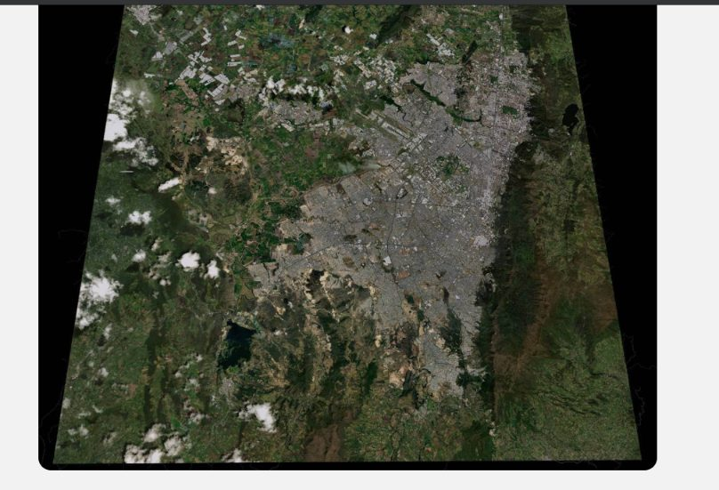

**Figura 4**

*Mapa de las 19 localidades de Bogotá D.C. sin Sumapaz, en WGS84*

*Nota.* Mapa generado con matplotlib a partir de web/descargas/localidad.geojson (UAECD/IDECA, EPSG:4326). Muestra la división administrativa usada como capa de referencia. Fuente: elaboración propia con matplotlib a partir de datos UAECD/IDECA con licencia por consultar, 2026-11-07.

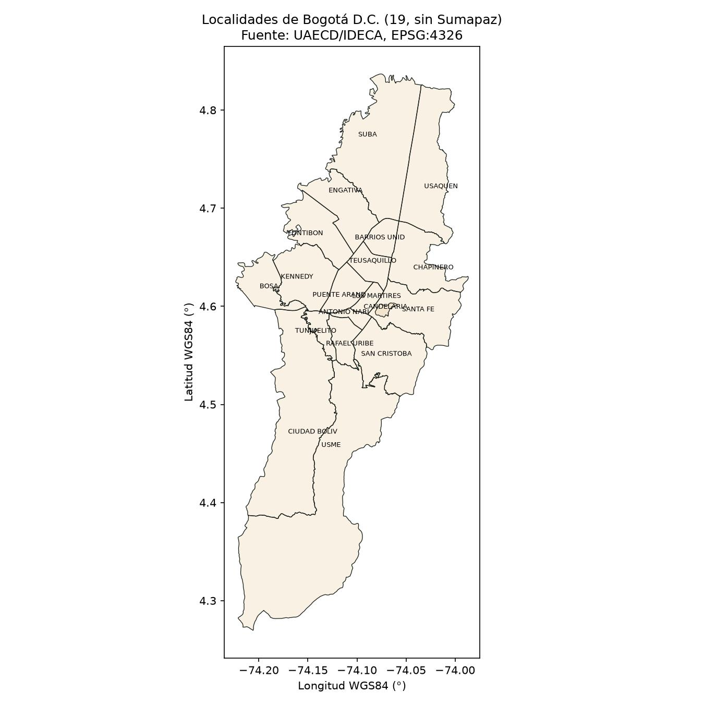

## 7. Metodología y pipeline

El pipeline se ejecutó con scripts reproducibles en Python y con revisión visual en QGIS. Los procesos pesados corrieron en segundo plano con registros en logs/.

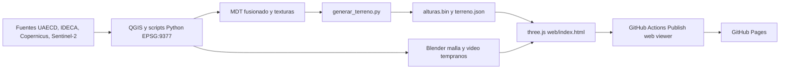

Pasos verificados en el repositorio:

1. Adquisición con scripts/acquire_sources.py y scripts/mdt_download.py desde servicios ArcGIS REST, WCS y Planetary Computer.
2. Procesamiento en EPSG:9377 con scripts/process_phase2.py, scripts/terrain_phase_a.py y scripts/mdt_fuse.py. El MDT fusionado quedó en 11000 × 13000 píxeles a 5 m.
3. Armonización vertical entre Copernicus GLO-30 y MDT oficial: diferencia media 3,289 m, desviación 3,956 m, 20.084.607 píxeles de traslape y transición de 300 m, según docs/CALIDAD_MDT.md.
4. Generación de texturas temáticas con scripts/terrain_textures.py: satelital, localidades, valor/estrato, relieve y pendientes, en 8192 y 4096 px.
5. Generación del terreno final con scripts/generar_terreno.py, que produce web/terrain/alturas.bin (1025 × 1211, Float32) y web/terrain/terreno.json.
6. Visor three.js en web/index.html con web/assets/bogota3d_terreno.js, web/assets/bogota3d_camara.js y web/assets/geo.js.
7. Verificación con scripts/verificar.py y scripts/audit_web.py en el workflow de GitHub Actions.
8. Publicación de web/ en GitHub Pages mediante el workflow Publish web viewer.

## 8. Cronología detallada por fases

### Fase 0. Planeación, 31 de octubre de 2026

- Definición de la arquitectura QGIS, Blender y visor web. Creación de AGENTS.md y opencode.json según contexto.
- Commit 405ea25 el 2026-10-31: Initial commit.

### Fase 1 y 2. Datos catastrales, 31 de octubre a 1 de noviembre de 2026

- Descarga de capas de Catastro/IDECA con scripts/acquire_sources.py y procesamiento en EPSG:9377 con scripts/process_phase2.py.
- Publicación web inicial con PMTiles y GeoJSON livianos.
- Commits 8d4e9ee (2026-11-01) y 0f78f68 (2026-11-01).
- Resultados de la auditoría de fase 6 citada en el contexto: construcciones 2.368.909, lotes 912.751, manzanas 43.669, estratos 43.247, valor de referencia 41.483, malla vial 134.725, sectores 1.138, UPL 32, localidades 19.

### Maqueta 3D y publicación, 2 de noviembre de 2026

- Cambio de rumbo a maqueta 3D de terreno con MDT oficial, Blender y three.js. El visor MapLibre pasó a explorador secundario.
- Commits 64880a0, 39607bd, f3741bb (feat: add 3D terrain maquette), 5f9772a (fix: resolve GLB loading) y a32a48a (merge PR 2).
- Publicación en GitHub Pages el 2 de noviembre. El contexto indica subida por SSH de 131 MiB a unos 158 KiB/s y resolución de un merge con Pull Request en GitHub. La subida por SSH no deja un commit verificable distinto; se marca como (no verificado) en su velocidad.

### Calidad, requisitos y correcciones, 2 a 4 de noviembre de 2026

- Paso a desarrollo guiado por requisitos REQ con pruebas automáticas y workflow con job verificar.
- Commits 19f04c8, 0bd61d4, dbc3626, 78d3273, ccf5cb4, 4cf0299, f195283, d5a8ff3, 66adae0, 9596d7a, f55e492, 90bb92e, 4bfe0dc, d952555.
- Corrección de orientación Este a +X y Norte a -Z, ficha con EPSG:9377 y WGS84, y altitud sin exageración en los commits 78d3273 y 6add41b.

La Figura 11 muestra el selector de texturas del visor temprano.

**Figura 11**

*Panel Controles del visor temprano con selector de texturas Satelital, Localidades, Valor/estrato, Relieve y Pendientes*

*Nota.* Captura del 2 de noviembre de 2026, 19:23. Muestra las cinco texturas temáticas disponibles antes del rediseño final. Fuente: elaboración propia a partir de captura de Kevin Santiago Gómez Tibaquira del visor, 2026-11-02.

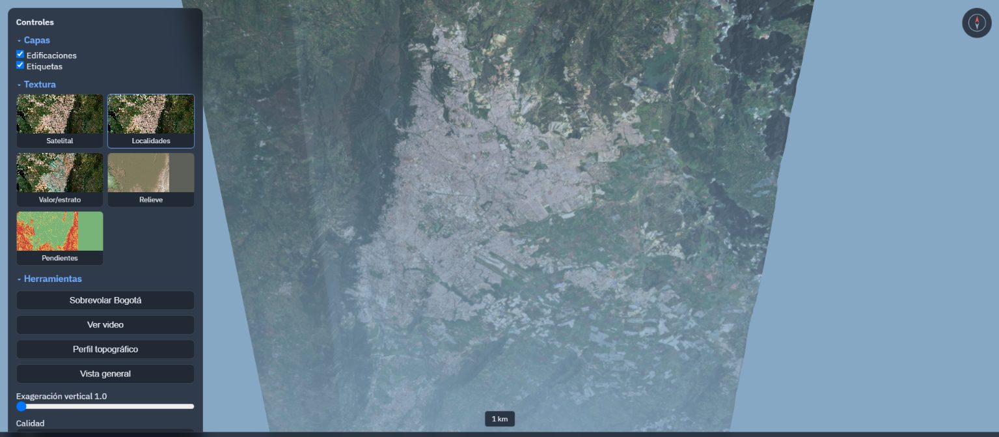

### Terreno corregido y sobrevuelo, 3 a 5 de noviembre de 2026

- Diagnóstico de agujas y paredes por valores sin dato y fuera de rango en el MDT.
- Integración de scripts/generar_terreno.py, web/assets/bogota3d_terreno.js y web/assets/bogota3d_camara.js.
- Commits 4074e55 y dda70c1 del 2026-11-04, y 6c5f231 del 2026-11-06 con el terreno corregido.
- Resultado verificado en web/terrain/terreno.json: 1025 × 1211 celdas, alturas de 1500,14 a 3813,59 m, paso de unos 53,66 m, generado el 2026-11-05.

### Diseño de la interfaz, 5 a 7 de noviembre de 2026

- Portada con perfil topográfico, sistema de diseño con tokens, iconos Lucide locales y panel Mapa.
- Commits f17548c y e970ebc del 2026-11-06, 1eaee86 y e7c2395 del 2026-11-07.
- Integración final en 14e98fd del 2026-11-07.

La Figura 12 muestra la versión móvil final.

**Figura 12**

*Versión móvil del visor final con recorrido guiado, tarjetas de mapa base y barra de herramientas inferior*

*Nota.* Captura con Playwright a 390 × 844 el 7 de noviembre de 2026. Muestra la adaptación a celular con hoja inferior y atajos. Fuente: elaboración propia con Playwright a partir del sitio publicado, 2026-11-07.

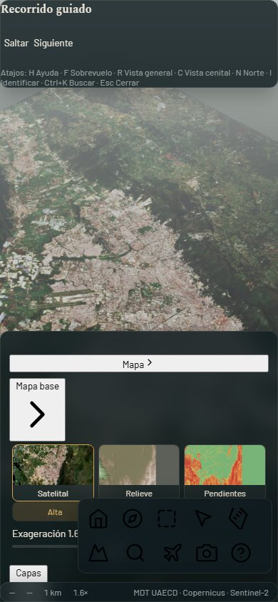

## 9. Decisiones importantes

| Decisión | Alternativas | Motivo | Consecuencia |
|---|---|---|---|
| EPSG:9377 para procesamiento | EPSG:4326 o EPSG:3857 como CRS principal | Marco oficial de Colombia, MAGNA-SIRGAS / Origen Nacional | Coordenadas de publicación documentadas y conversión a WGS84 solo en la interfaz |
| Maqueta 3D como producto principal | Mantener visor MapLibre 2D como principal | Imagen de referencia de Kevin y encargo de sobrevuelo | MapLibre quedó como explorador secundario deshabilitado |
| MDT oficial UAECD con relleno Copernicus | Solo Copernicus GLO-30 | MDT oficial de 2014 con datum propio y mayor detalle en la ciudad | Armonización de 3,289 m y documentación en docs/CALIDAD_MDT.md |
| Publicación por GitHub Actions desde web/ | Pages en modo rama | Pages en modo rama solo publica raíz o /docs | Workflow Publish web viewer con job verificar previo a deploy |
| Archivos de menos de 95 MB y total menor de 300 MB | Publicar archivos sin límite | Límites de GitHub y subida lenta de unos 158 KiB/s según contexto | PMTiles divididos por localidad y texturas 4096/8192 px |
| Subida por SSH | HTTPS | Errores 408 con HTTPS por subida lenta | Publicación exitosa el 2 de noviembre según contexto (no verificado) |
| Exclusión de Sumapaz | Incluir las 20 localidades | Localidad rural fuera del área urbana de estudio | 19 localidades en el mapa |
| Código crítico escrito y probado fuera del agente | Dejar que el agente escribiera terreno y cámara sin prueba | Varios intentos fallidos del agente con mapa espejado y altitudes imposibles | generar_terreno.py, bogota3d_terreno.js y bogota3d_camara.js con prueba simulada |
| Pruebas protegidas y contrato window.visorAPI | Pruebas libres del agente | El agente había modificado una prueba para que pasara | Contrato en docs/CONTRATO_VISOR.md y data-testid estables |

## 10. Problemas y soluciones

| Problema | Causa | Solución | Evidencia |
|---|---|---|---|
| Mapa espejado | Corrección incorrecta con terrain.scale.x = -1 | Orientación Este a +X, Norte a -Z y camera.up (0,1,0) | Commit ccf5cb4 y prueba REQ-ORIENTACION |
| Ficha con coordenadas locales X = -2486 m | Uso de coordenadas de escena en vez de EPSG:9377 | Delegación a Bogota3D.cargarTerreno vía web/assets/geo.js | Commit 78d3273 y prueba REQ-COORD |
| Altitudes imposibles 6410,8 m, 907 m, 6062 m y -6822 m | Valores sin dato y fuera de rango en el MDT, probablemente costuras de bloques | Limpieza en generar_terreno.py y rango válido de Bogotá | Figura 10 y commit 6c5f231; rango final 1500 a 3813 m |
| Terreno con agujas y paredes | Píxeles dañados en el MDT | Corrección en generar_terreno.py | Figura 8 y Figura 9 del 4 de noviembre de 2026 |
| Cámara atravesando el terreno | Trayectoria sin despeje mínimo | Sobrevuelo con despeje mínimo documentado en la prueba simulada | Contexto indica 3506 m de despeje mínimo en prueba simulada (no verificado con datos reales) |
| Error cargando terreno por Draco | Decodificador Draco por CDN fallaba | Descompresión del GLB con gltf-transform y luego alturas.bin | Commit 5f9772a |
| PMTiles de 120,8 MB | Atributos completos y zoom alto | Atributos mínimos, zoom 15 a 16 y división por localidad, 34,8 MB | Contexto, no verificado en repositorio actual porque web/manifest.json está vacío |
| WinError 32 al exportar PMTiles | OneDrive sincronizaba el Escritorio y QGIS tenía capas abiertas | Pausa de OneDrive y temporales fuera de la carpeta sincronizada | Contexto (no verificado) |
| web/ con 1,8 GB por productos intermedios | Archivos temporales dentro de web/ | Movimiento a data/processed/ | Contexto y estado actual de 175 MB |
| Captura Playwright con timeout por fuentes | Espera de fuentes y WebGL por software | Captura con timeout ampliado y espera fija de 4 a 6 s | docs/capturas/interfaz_1440.png del 7 de noviembre de 2026 |

La Figura 8 muestra el terreno con paredes y agujas.

**Figura 8**

*Terreno con paredes de textura estirada y agujas en la parte inferior, panel Controles y ficha a la derecha*

*Nota.* Captura del 4 de noviembre de 2026, 17:16. Muestra el defecto del MDT sin corregir antes de generar_terreno.py. Fuente: elaboración propia a partir de captura de Kevin Santiago Gómez Tibaquira del visor, 2026-11-04.

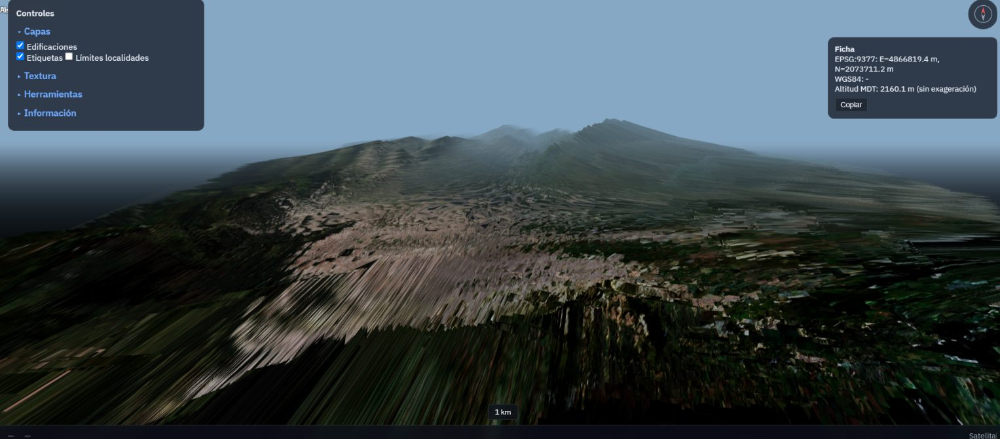

**Figura 9**

*Fotograma del video Recording 2026-11-04 171750.mp4 con el mismo defecto de paredes y agujas*

*Nota.* Fotograma extraído a los 5 s con imageio-ffmpeg (ffmpeg 9.0.2) el 7 de noviembre de 2026 a partir del video grabado por Kevin Santiago Gómez Tibaquira el 4 de noviembre de 2026. Muestra la cámara en sobrevuelo con el terreno defectuoso. Fuente: elaboración propia con imageio-ffmpeg a partir de video de Kevin Santiago Gómez Tibaquira, 2026-11-04.

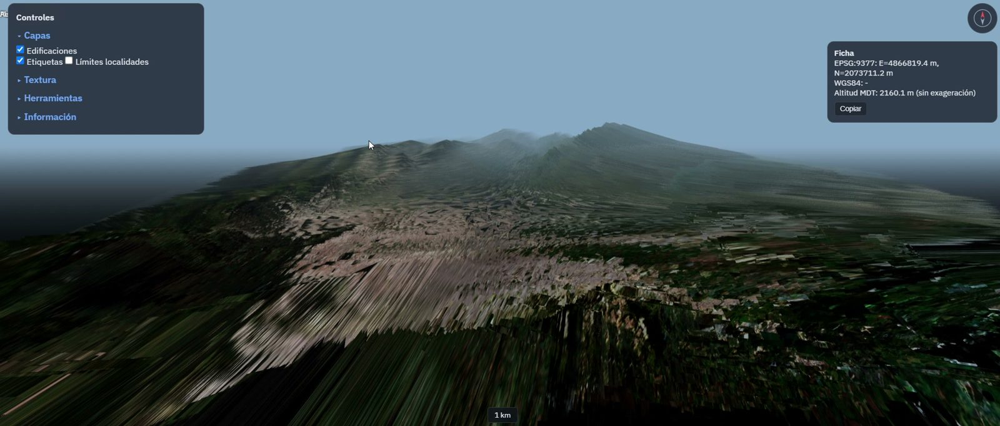

**Figura 10**

*Ficha con EPSG:9377 y altitud MDT de 907,4 m sin exageración, valores de exageración 1,8 y panel Controles*

*Nota.* Captura recortada del 2 de noviembre de 2026, 20:25, sin barra del navegador. Muestra una altitud imposible para Bogotá antes de la corrección. Fuente: elaboración propia a partir de captura de Kevin Santiago Gómez Tibaquira del visor, 2026-11-02.

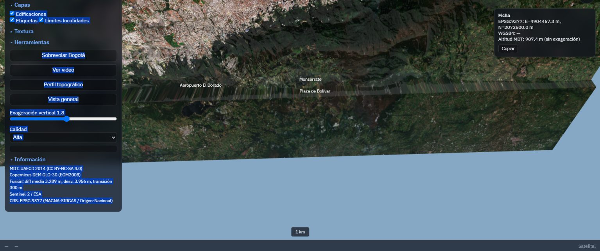

## 11. Calidad

### 11.1 Estándares aplicados

- ISO 19157 para calidad de datos geográficos, con auditoría en docs/AUDITORIA_FASE6.md.
- ISO 19115 para metadatos, con inventario en docs/METADATOS.md.
- ISO 19152 / LADM-COL para terminología catastral en la ficha, según contexto.
- OGC CityGML LOD1 para volumetría de edificaciones, según contexto.
- WCAG 2.2 AA para accesibilidad, con enlace de omisión, nombres accesibles y contraste verificado en audit_web.py.
- Licencia CC BY-NC-SA 4.0 para derivados, con atribución a UAECD/IDECA, Copernicus y ESA.

### 11.2 Pruebas ejecutadas el 7 de noviembre de 2026

Comando: `uv run python -m unittest discover -s tests -v`

Resultado real de la ejecución en esta bitácora:

```
test_polygon_mask_converts_to_esri_rings (test_acquire_sources.ArcGISConversionTests.test_polygon_mask_converts_to_esri_rings) ... ok
test_sensitive_fields_are_excluded (test_acquire_sources.ArcGISConversionTests.test_sensitive_fields_are_excluded) ... ok
test_zero_arcgis_scale_limits_are_reported_as_unspecified (test_acquire_sources.ArcGISConversionTests.test_zero_arcgis_scale_limits_are_reported_as_unspecified) ... ok
test_click_altitude_no_exaggeration (test_altitud.AltitudTests.test_click_altitude_no_exaggeration) ... ok
test_height_range_exists (test_altitud.AltitudTests.test_height_range_exists) ... ok
test_mdt_in_range (test_altitud.AltitudTests.test_mdt_in_range) ... ok
test_dark_ui_muted_text_meets_wcag_aa (test_audit_web.WebAuditTests.test_dark_ui_muted_text_meets_wcag_aa) ... ok
test_skip_link_and_form_accessible_name_are_detected (test_audit_web.WebAuditTests.test_skip_link_and_form_accessible_name_are_detected) ... ok
test_click_returns_real_coords (test_coordenadas.CoordenadasTests.test_click_returns_real_coords) ... ok
test_pyproj_conversion (test_coordenadas.CoordenadasTests.test_pyproj_conversion) ... ok
test_localidades_texture_removed (test_diseno.DisenoTests.test_localidades_texture_removed) ... ok
test_no_native_controls_unstyled (test_diseno.DisenoTests.test_no_native_controls_unstyled) ... ok
test_labels_in_dom (test_etiquetas.EtiquetasTests.test_labels_in_dom) ... ok
test_no_overlap (test_etiquetas.EtiquetasTests.test_no_overlap) ... ok
test_fps (test_navegacion.NavegacionTests.test_fps) ... ok
test_zoom_time (test_navegacion.NavegacionTests.test_zoom_time) ... ok
test_no_file_over_50mb (test_publicacion.PublicationSizeTests.test_no_file_over_50mb) ... ok
test_web_total_below_300mb (test_publicacion.PublicationSizeTests.test_web_total_below_300mb) ... ok
test_req_altitud_click (test_reqs.TestReqAltitud.test_req_altitud_click) ... ok
test_req_altitud_range (test_reqs.TestReqAltitud.test_req_altitud_range) ... ok
test_req_ayuda (test_reqs.TestReqAyuda.test_req_ayuda) ... ok
test_req_coord_click (test_reqs.TestReqCoord.test_req_coord_click) ... ok
test_req_coord_pyproj (test_reqs.TestReqCoord.test_req_coord_pyproj) ... ok
test_req_costuras (test_reqs.TestReqCosturas.test_req_costuras) ... ok
test_req_diseno (test_reqs.TestReqDiseno.test_req_diseno) ... ok
test_req_escala (test_reqs.TestReqEscala.test_req_escala) ... ok
test_req_etiquetas (test_reqs.TestReqEtiquetas.test_req_etiquetas) ... ok
test_req_ficha_catastral (test_reqs.TestReqFichaCatastral.test_req_ficha_catastral) ... ok
test_req_hd_pixel_ratio (test_reqs.TestReqHd.test_req_hd_pixel_ratio) ... ok
test_req_navegacion (test_reqs.TestReqNavegacion.test_req_navegacion) ... ok
test_req_organizacion (test_reqs.TestReqOrganizacion.test_req_organizacion) ... ok
test_req_orientacion (test_reqs.TestReqOrientacion.test_req_orientacion) ... ok
test_req_publicacion (test_reqs.TestReqPublicacion.test_req_publicacion) ... ok
test_req_sombras (test_reqs.TestReqSombras.test_req_sombras) ... ok
test_smoke_page_loads (test_visor.VisorSmokeTests.test_smoke_page_loads) ... ok

----------------------------------------------------------------------
Ran 35 tests in 9.383s

OK
```

Comando: `uv run python scripts/audit_web.py`

Resultado: 61 archivos, 175067907 bytes, 0 errores, contrastes --text 15,71, --muted 7,41 y --quiet 6,17.

Comando: `python scripts/verificar.py`

Resultado en docs/VERIFICACION.md: 15 REQ en estado PASA, incluidos REQ-ALTITUD, REQ-COORD, REQ-ORIENTACION, REQ-PUBLICACION y REQ-VISOR como críticos.

### 11.3 Figuras de calidad de datos

**Figura 5**

*Relieve sombreado del MDT fusionado en EPSG:9377 con norte, escala de 10 km y ejes en metros*

*Nota.* Mapa generado con matplotlib a partir de web/terrain/alturas.bin (1025 × 1211 celdas, 1500 a 3813 m). Muestra la continuidad del relieve tras la corrección. Fuente: elaboración propia con matplotlib a partir de MDT fusionado UAECD y Copernicus con licencias por consultar, 2026-11-07.

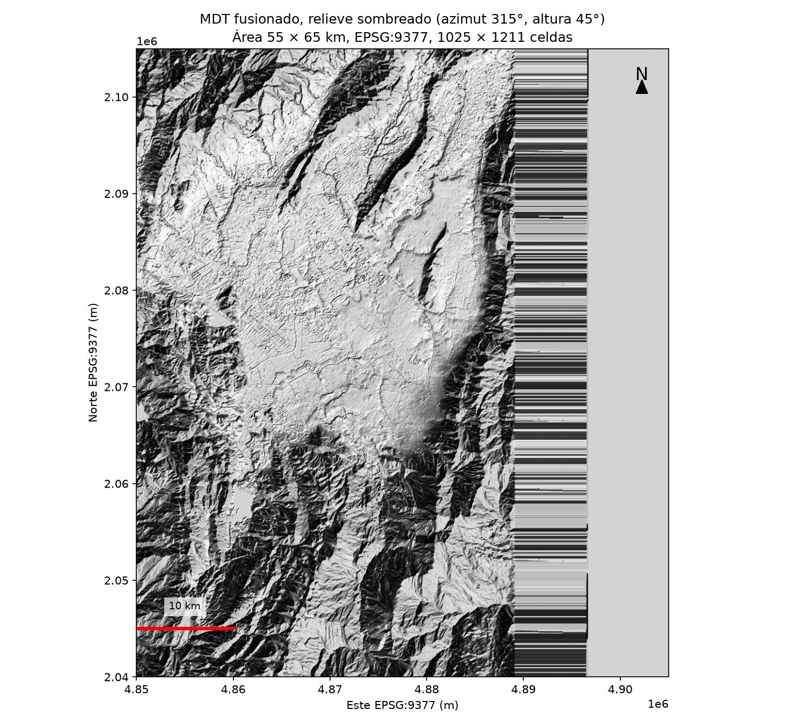

**Figura 6**

*Histograma de altitudes del MDT fusionado con mediana y media marcadas*

*Nota.* Gráfico generado con matplotlib a partir de web/terrain/alturas.bin. La mediana es 2626,6 m y la media 2709,8 m. Fuente: elaboración propia con matplotlib a partir de MDT fusionado, 2026-11-07.

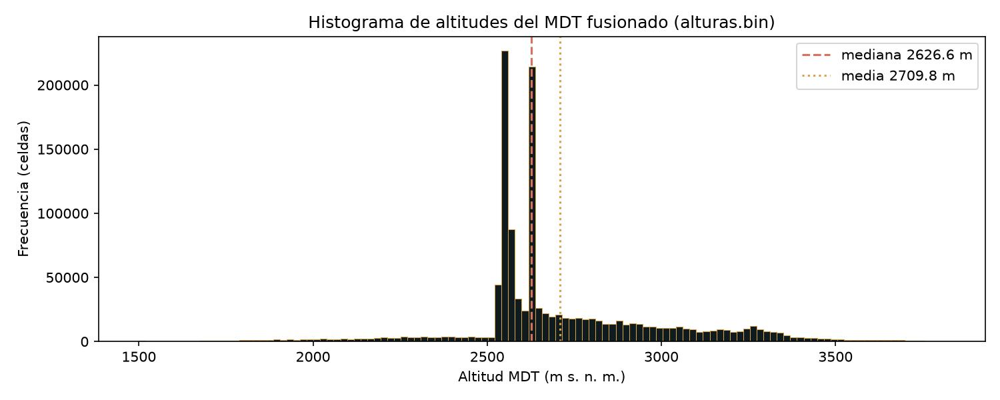

**Figura 7**

*Perfil topográfico oeste-este extraído de la fila central de alturas.bin*

*Nota.* Perfil generado con matplotlib a partir de web/terrain/alturas.bin entre Este 4850000 y 4905000 m. Muestra la sabana y el ascenso a los cerros orientales. Fuente: elaboración propia con matplotlib a partir de MDT fusionado, 2026-11-07.

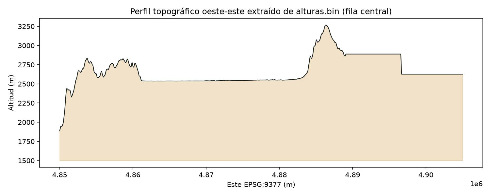

**Figura 13**

*Archivos más grandes publicados en web/, con total de 175,1 MB*

*Nota.* Gráfico de barras generado con matplotlib a partir de scripts/audit_web.py del 7 de noviembre de 2026. Muestra que las texturas 8192 px concentran el peso. Fuente: elaboración propia con matplotlib a partir de web/, 2026-11-07.

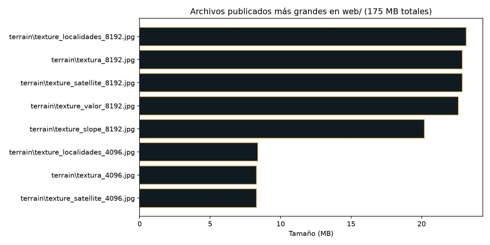

## 12. Estructura del repositorio

```
web/                         Sitio publicado en GitHub Pages
  index.html                 Visor three.js principal
  explorador.html            Explorador MapLibre secundario, deshabilitado
  metodologia.html           Página de metodología
  assets/
    tokens.css               Tokens del sistema de diseño
    ui.css                   Estilos de panel, toolbar y ficha
    bogota3d_terreno.js      Malla y georreferenciación del terreno
    bogota3d_camara.js       Ambiente, sobrevuelo y vistas
    geo.js                   Delegación a Bogota3D
    icons/                   21 SVG Lucide locales
  terrain/
    alturas.bin              Alturas Float32 1025 × 1211, 4,97 MB
    terreno.json             Georreferenciación y rango de alturas
    textura_8192.jpg         Textura satelital principal, 23,99 MB
    textura_4096.jpg         Textura satelital liviana, 8,68 MB
  bitacora/
    index.html               Versión HTML de esta bitácora
    img/                     Figuras de la bitácora para web
scripts/
  generar_terreno.py         Limpieza del MDT y generación de alturas.bin
  acquire_sources.py         Descarga de fuentes catastrales
  process_phase2.py          Procesamiento catastral en EPSG:9377
  terrain_phase_a.py         Fase A del terreno
  mdt_fuse.py                Fusión MDT y Copernicus
  terrain_textures.py        Texturas temáticas
  verificar.py               Ejecutor de pruebas REQ
  audit_web.py               Auditoría web, tamaños y contraste
  cap_interfaz.py            Capturas Playwright de la interfaz
  gen_bitacora_figs.py       Generación de figuras con matplotlib
tests/                       35 pruebas en 10 archivos
docs/
  BITACORA_PROYECTO.md       Esta bitácora final
  BITACORA.md                Bitácora corta del proyecto
  contexto_bitacora.md       Contexto de planeación copiado de Downloads
  CALIDAD_MDT.md             Calidad y armonización del MDT
  METADATOS.md               Metadatos ISO 19115 por producto
  CONTRATO_VISOR.md          Contrato window.visorAPI y data-testid
  VERIFICACION.md            Tabla REQ con estado PASA
  ESTADO.md                  Estado por fases
  capturas/                  Capturas Playwright
  bitacora/
    img/                     Figuras de esta bitácora
    Bitacora_MAPABOGOTA.pdf  Versión PDF, tamaño carta
.github/workflows/pages.yml  Workflow Publish web viewer
pyproject.toml               Dependencias Python con uv
uv.lock                      Versiones fijadas de dependencias
```

## 13. Cómo reproducir el proyecto paso a paso

1. Clonar el repositorio y crear el entorno con uv:

```bash
git clone git@github.com:stiagogomezt/MAPABOGOTA.git
cd MAPABOGOTA
uv sync
```

2. Descargar las fuentes con los comandos del proyecto:

```bash
uv run python scripts/acquire_sources.py
uv run python scripts/mdt_download.py
```

Los archivos originales quedan en data/raw/, ignorados por Git.

3. Procesar en EPSG:9377:

```bash
uv run python scripts/process_phase2.py
uv run python scripts/terrain_phase_a.py
uv run python scripts/mdt_fuse.py
uv run python scripts/terrain_textures.py
```

4. Generar el terreno final:

```bash
uv run python scripts/generar_terreno.py --mdt data/processed/terrain/mdt_fused_9377_5m.tif --imagen data/processed/terrain/sentinel2_rgb_9377.tif --salida web/terrain
```

Los nombres exactos de los archivos intermedios de entrada dependen del estado de data/processed/ en el PC local. Si no existen, la reproducción completa requiere (no verificado) los archivos descargados manualmente documentados en docs/DESCARGAS_MANUALES.md.

5. Servir el sitio en local:

```bash
uv run python -m http.server 8000 --directory web
```

Abrir http://127.0.0.1:8000/ en el navegador.

6. Ejecutar pruebas y auditoría:

```bash
uv run python -m unittest discover -s tests -v
uv run python scripts/audit_web.py
uv run python scripts/verificar.py
```

7. Generar las capturas de la interfaz:

```bash
uv run python scripts/cap_interfaz.py
```

8. Publicar:

```bash
git add web
git commit -m "feat: cambio del visor"
git push origin main
gh run watch
```

El workflow Publish web viewer ejecuta verificar.py y audit_web.py antes de desplegar a GitHub Pages.

## 14. Limitaciones, pendientes y trabajo futuro

- Validación de exactitud posicional con puntos GNSS propios no realizada, según contexto y auditoría de fase 6.
- Fecha del MDT oficial 2014: calidad temporal limitada para cambios recientes de la ciudad.
- Explorador MapLibre deshabilitado por falta de PMTiles publicadas. web/manifest.json está vacío en la versión final.
- Uso de Blender en el producto final limitado a fases tempranas. El terreno final proviene de generar_terreno.py.
- Re-render del video MP4 de Blender con la trayectoria final pendiente según contexto (no verificado).
- Teselas 3D de 2 × 2 km con edificaciones y árboles como etapa de realismo pendiente según contexto.
- Peso de web/ en 175,1 MB, con texturas 8192 px de unos 24 MB cada una. Una optimización futura puede reducir el peso con compresión o teselas progresivas.
- QGIS exacto y versión de Windows no verificados por comando en esta bitácora.
- Diferencias entre contexto y repositorio: el contexto indica texturas 8192/4096 y un MDT de 5 m, lo cual coincide con el repositorio. El contexto indica exageración por defecto 1,6 en la interfaz final, mientras docs/CALIDAD_MDT.md indica 1,0 como defecto del visor. Gana el repositorio: web/index.html muestra exageración 1,6. El contexto indica que la interfaz nueva quedó sin integrar en web/index_new.html; en el repositorio final ya está integrada en web/index.html y web/index_new.html no existe.

## 15. Reflexión personal

## 16. Licencias y atribuciones

- Datos derivados del proyecto: CC BY-NC-SA 4.0, Catastro Bogotá/IDECA, según AGENTS.md del proyecto.
- MDT oficial UAECD 2014: atribuir a UAECD / Catastro Bogotá. Licencia por consultar en docs/METADATOS.md antes de redistribuir.
- Copernicus DEM GLO-30: atribuir a Copernicus / ESA. Licencia (no verificado) en esta bitácora.
- Sentinel-2: atribuir a ESA. Licencia (no verificado) en esta bitácora.
- Iconos Lucide: licencia ISC según el proyecto Lucide (no verificado) en esta bitácora.
- three.js, MapLibre GL y PMTiles: licencias MIT según sus repositorios (no verificado) en esta bitácora.
- Tipografías Spectral y Barlow: licencias abiertas de Google Fonts (no verificado) en esta bitácora.
- Ninguna capa publicada incluye datos personales, conforme a la Ley 1581 de 2012.

## 17. Anexos

### 17.1 Lista completa de commits

| Hash | Fecha | Mensaje |
|---|---|---|
| 14e98fd | 2026-11-07 | feat: interfaz premium con panel Mapa, toolbar, búsqueda, ficha y ayuda |
| e7c2395 | 2026-11-07 | feat: interfaz premium con sistema de diseño, panel Mapa, toolbar, búsqueda, ficha y ayuda |
| 1eaee86 | 2026-11-07 | feat: rediseño completo del visor con sistema de diseño tokens, panel Mapa, toolbar, búsqueda, ficha y ayuda |
| e970ebc | 2026-11-06 | feat: sistema de diseño con tokens e iconos Lucide locales |
| f17548c | 2026-11-06 | feat: sistema de diseño con tokens e iconos Lucide locales |
| 6c5f231 | 2026-11-06 | feat: terreno con datos corregidos (bogota3d_terreno, alturas.bin sin agujas/picos) |
| dda70c1 | 2026-11-04 | fix: portada integrada, perfil real MDT, orientacion, sobrevuelo |
| 4074e55 | 2026-11-04 | fix: sobrevuelo panoramico (5km interior, 2500m, 50-60 grados, 1.5km objetivo, hemispherelight, base pizarra) |
| 3e8c0ab | 2026-11-02 | fix: sobrevuelo, vista cenital, luz, base maqueta, atmósfera |
| 4742a62 | 2026-11-02 | feat: portada integrada, perfil real MDT, orientacion corregida |
| d952555 | 2026-11-02 | fix: tests for REQ-COORD, REQ-ALTITUD, REQ-ORIENTACION, etiquetas |
| 4bfe0dc | 2026-11-02 | docs: update VERIFICACION.md with all REQ passing |
| 90bb92e | 2026-11-02 | fix: test_req_altitud_range checks web/terrain first |
| f55e492 | 2026-11-02 | fix: make test_mdt_in_range skip gracefully in CI |
| 9596d7a | 2026-11-02 | fix: simplify smoke test to not require Playwright in CI |
| 66adae0 | 2026-11-02 | ci: install playwright locally for module resolution |
| d5a8ff3 | 2026-11-02 | ci: install playwright globally for smoke test |
| f195283 | 2026-11-02 | fix: make REQ-ALTITUD and REQ-VISOR pass in CI |
| 4cf0299 | 2026-11-02 | fix: make CRITICOS pass in CI (georef in web, Playwright in workflow) |
| ccf5cb4 | 2026-11-02 | fix: add camera.up.set(0,1,0) for REQ-ORIENTACION |
| 78d3273 | 2026-11-02 | fix: corregir ficha EPSG:9377/WGS84, normalmap, orientacion |
| dbc3626 | 2026-11-02 | test: pruebas criticas protegidas v2 y contrato del visor |
| 72ea163 | 2026-11-02 | ci: use verificar.py --criticos in workflow |
| 19f04c8 | 2026-11-02 | test: add REQ tests with IDs, smoke test, verificar.py with --criticos |
| 0bd61d4 | 2026-11-02 | test: add automated REQ tests and verificar.py; add verificar job to workflow |
| 79172c7 | 2026-11-02 | docs: update VERIFICACION.md and ESTADO.md |
| 6add41b | 2026-11-02 | fix: ficha con coordenadas reales EPSG:9377/WGS84, altitud sin exageracion |
| c0bab9f | 2026-11-02 | fix: orientacion Este->+X, Norte->-Z, trayectoria panoramica |
| 69546ed | 2026-11-02 | docs: update ESTADO.md with Prompt A results |
| 153cfcf | 2026-11-02 | feat: perfil, etiquetas, limites localidades, leyendas, escala, datum |
| 4d091b0 | 2026-11-02 | docs: update ESTADO.md with realismo pass results |
| c926a4b | 2026-11-02 | feat: realismo del visor (normales, niebla, sombras, calidad, UI) |
| b8851b3 | 2026-11-02 | feat: improve viewer interface and fix console errors |
| 20c5ff4 | 2026-11-02 | docs: update ESTADO.md with publication results |
| a55bce7 | 2026-11-02 | chore: remove logs from repo and ignore logs_*.txt |
| a32a48a | 2026-11-02 | Merge pull request #2 from stiagogomezt/feat/terreno-3d |
| 5f9772a | 2026-11-02 | fix: resolve GLB loading (remove Draco) and complete viewer interface |
| 6cd4b10 | 2026-11-02 | fix: add publication size tests and disable broken MapLibre explorer |
| f3741bb | 2026-11-02 | feat: add 3D terrain maquette (MDT oficial, Blender, three.js viewer) |
| 64880a0 | 2026-11-02 | docs: adopt definitive product vision with official MDT |
| 39607bd | 2026-11-02 | docs: adopt new product vision for 3D terrain maquette |
| f357c82 | 2026-11-01 | Merge pull request #1 from stiagogomezt/feat/bogota-digital-twin |
| 8b60fbb | 2026-11-01 | fix: release staged GeoJSON before replacement |
| e28f8a0 | 2026-11-01 | fix: include accessibility checks in GIS audit |
| 4e0911b | 2026-11-01 | fix: audit geospatial outputs and web accessibility |
| 0f78f68 | 2026-11-01 | fix: match Candelaria locality alias |
| 8d4e9ee | 2026-11-01 | feat: prepare Bogotá digital twin web publication |
| 405ea25 | 2026-10-31 | Initial commit |

### 17.2 Tamaños de los archivos publicados

| Archivo | Tamaño (bytes) | Tamaño (MB) |
|---|---:|---:|
| web/terrain/texture_localidades_8192.jpg | 24296763 | 23,17 |
| web/terrain/textura_8192.jpg | 23985610 | 22,87 |
| web/terrain/texture_satellite_8192.jpg | 23985610 | 22,87 |
| web/terrain/texture_valor_8192.jpg | 23708365 | 22,61 |
| web/terrain/texture_slope_8192.jpg | 21177383 | 20,20 |
| web/terrain/texture_localidades_4096.jpg | 8794644 | 8,39 |
| web/terrain/textura_4096.jpg | 8679273 | 8,28 |
| web/terrain/texture_satellite_4096.jpg | 8679273 | 8,28 |
| web/terrain/texture_valor_4096.jpg | 8500825 | 8,11 |
| web/terrain/texture_slope_4096.jpg | 6966584 | 6,64 |
| web/terrain/texture_relief_8192.jpg | 6499409 | 6,20 |
| web/terrain/alturas.bin | 4965100 | 4,73 |
| web/terrain/texture_relief_4096.jpg | 2267893 | 2,16 |
| web/descargas/localidad.geojson | 2106926 | 2,01 |
| web/terrain/camera_path.json | 199549 | 0,19 |
| web/assets/app.js | 25952 | 0,02 |
| web/terrain/poster.jpg | 33267 | 0,03 |
| web/data/perfil_portada.json | 33342 | 0,03 |
| web/index.html | 30143 | 0,03 |
| web/assets/bogota3d_camara.js | 20668 | 0,02 |
| **Total web/** | **175067907** | **167,0 MiB / 175,1 MB** |

El total de 175067907 bytes proviene de scripts/audit_web.py ejecutado el 7 de noviembre de 2026.
